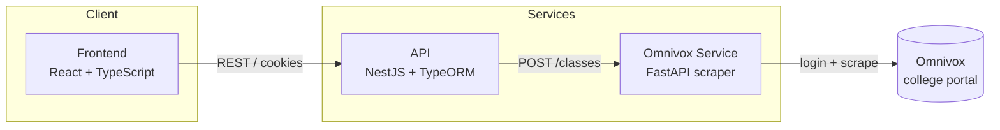

# TF-Calendar

A smart scheduling platform built for CEGEP students. TF-Calendar lets students manage a personal calendar of courses, events, and group activities, automatically detects scheduling conflicts, supports friend invitations, and can import a real class schedule directly from a student's Omnivox portal.

This repo is the **entry point** for the project: it ties together three services as git submodules so the whole system can be cloned and understood in one place.

## Architecture



- The **frontend** is a React application that talks only to the API over a typed REST/cookie-session interface.
- The **API** owns auth, users, calendars, and the scheduling/conflict-detection logic. 
- The **Omnivox service** is a focused Python microservice whose only job is to simulate a real login to a student's Omnivox account and scrape their class schedule into clean, structured data.

Splitting the scraper out from the API keeps the two concerns cleanly separated: the API's job is business logic, the scraper's job is imitating a browser against a third-party site that offers no official API — different failure modes, different language/tooling needs (Python's scraping ecosystem vs. NestJS).

## Repositories

| Service | Repo | Stack |
|---|---|---|
| Frontend | [TF-Calendar-Frontend](https://github.com/Haroune07/TF-Calendar-Frontend) | React 19, TypeScript, React Router 7, Vite |
| API | [TF-Calendar](https://github.com/ddryad/TF-Calendar) | NestJS 11, TypeORM, SQLite, Passport |
| Omnivox scraper | [TF-Calendar-Omnivox](https://github.com/ddryad/TF-Calendar-Omnivox) | FastAPI, Requests, BeautifulSoup |

Each repo's own README covers its internals, endpoints, and setup in detail — this one is about how they fit together.

## Highlighted features

- **Conflict detection** — the API scans a user's schedule for overlapping items, reports the exact overlap window, and can suggest free slots in the following week when a reschedule would collide with something else.
- **Single-table inheritance scheduling model** — a shared `Programmable` entity specializes into `Activite`, `Evenement`, and `ActiviteGroupe`, so courses, multi-day events, and group activities all share one query surface.
- **Factory-pattern invitations** — friend requests and activity invitations are built through an `InvitationFactory`, so adding a new invitation type doesn't touch existing logic.
- **Live Omnivox import** — a student enters their Omnivox credentials once; the scraper logs in on their behalf, pulls their real class schedule, and the API inserts it as calendar activities in a single call.
- **Dual auth** — email/password (scrypt-hashed) and Google OAuth 2.0, both resolving to the same session-cookie-based auth guard.

## Getting started

Clone with submodules:

```bash
git clone --recurse-submodules https://github.com/ddryad/TF-Calendar-Root.git
cd TF-Calendar
```

If you already cloned without `--recurse-submodules`:

```bash
git submodule update --init --recursive
```

Then start each service (see each submodule's README for full setup and environment variables):

```bash
# 1. Omnivox scraper — http://localhost:8000
cd TF-Calendar-Omnivox
python -m venv venv && source venv/bin/activate
pip install -r requirements.txt
uvicorn main:app --reload --port 8000

# 2. API — http://localhost:3000
cd ../TF-Calendar
npm install
cp .env.example .env
npm run start:dev

# 3. Frontend — http://localhost:5173
cd ../TF-Calendar-Frontend
npm install
cp .env.example .env
npm run dev
```

Once all three are running, open `http://localhost:5173` — sign up, create a calendar, and (optionally) add Omnivox credentials in your profile to import a real schedule.

## Updating submodules

Each submodule is pinned to a specific commit. To pull in the latest changes from a submodule's own repo:

```bash
git submodule update --remote <submodule-name>
git add <submodule-name>
git commit -m "Update <submodule-name> to latest"
```
